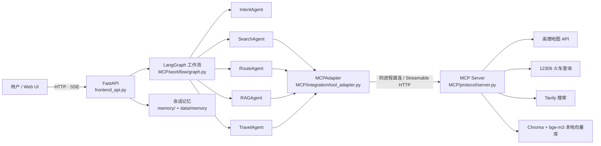
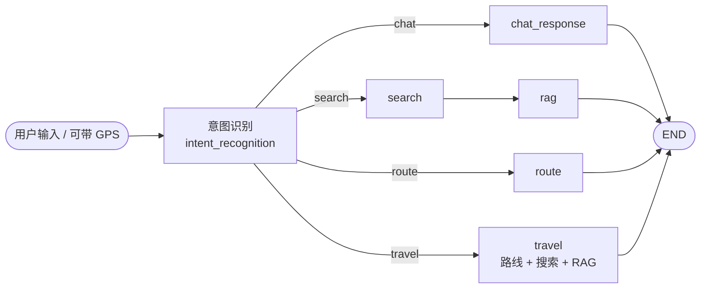

# 旅游助手智能体 · LangGraph + MCP

> 基于 **LangGraph** 编排、**MCP（Model Context Protocol）** 统一工具接入的多智能体旅行助手。
> 用户输入自然语言，系统识别意图后路由到对应 Agent，经由 MCP 工具调用高德地图、12306、Tavily 搜索与本地 RAG 知识库，最终生成完整的出行方案。

本仓库 `mcp-v1` 分支为 **MCP 重构版**（`project_mcp`），旧版基于 `agents/ + mcp_server/` 的实现保留在 `master` 分支。

---

## ✨ 功能特性

| 意图 | 能力 | 触发示例 |
|---|---|---|
| 💬 `chat` | 不调工具的纯 LLM 闲聊 | “你好”“介绍一下你自己” |
| 🗺️ `route` | 驾车 / 公交 / 火车路线规划，`auto` 模式下按距离（>120 km）自动选火车 | “北京到上海的路线” |
| 🔍 `search` | Tavily 深度搜索景点、美食、住宿、攻略，并写入 RAG 知识库 | “西安有什么好玩的” |
| 🌍 `travel` | 行程综合规划：路线 + 攻略 + 知识库检索，输出完整出行方案 | “去成都玩三天怎么安排” |

其他能力：

- **本地 RAG**：`bge-m3` 本地嵌入 + Chroma 持久化向量库，支持入库 / 检索 / 统计 / 清空，可通过 `RAG_ENABLED` 一键关闭
- **GPS 定位**：浏览器定位 → 高德逆地理编码 → 自动作为出行起点
- **多轮记忆**：按 `session_id` 以 JSON 文件持久化对话，提供会话增删查接口
- **SSE 流式输出**：`/chat/stream` 逐步推送阶段消息与内容片段
- **Web 界面**：单页前端挂载在 `/ui`，无需额外构建

---

## 🏗️ 系统架构



- **MCP 连接有两种模式**：`MCP_HTTP_URL` 为空（默认）时与 MCP Server **同进程直连**，无需额外启动服务；填 `http://127.0.0.1:9000/mcp` 则改为远程 **Streamable HTTP** 模式，可先启动 `start_mcp.bat`。
- **LLM 唯一入口**：所有 Agent 通过 `MCP/core/llm_client.py` 的 `LLMClientFactory` 使用 `.env` 中的 `CHATGPT_FREE_*`（OpenAI 兼容接口）。

---

## 📁 目录结构

```text
langgraph_demo (分支 mcp-v1)
├── main.py                    # 命令行入口（单次运行示例）
├── frontend_api.py            # FastAPI 服务：REST + SSE + 静态页面
├── start_mcp.bat              # Windows 一键启动 MCP 服务（/mcp）
├── web/index.html             # 前端单页（挂载到 /ui）
├── memory/                    # 会话记忆模块（JSON 存储 + REST 路由）
├── instruction/               # 项目报告与说明文档
├── data/memory/               # 会话 JSON（运行时生成，已被 git 忽略）
└── MCP/
    ├── config/settings.py     # 配置层：pydantic-settings 读取 .env
    ├── core/                  # LLM 客户端工厂、日志
    ├── agents/specialized/    # 意图 / 搜索 / 路线 / RAG / 综合规划 Agent
    ├── workflow/              # LangGraph 图定义与状态
    ├── protocol/              # MCP 服务端 (server.py) / 客户端 (client.py)
    ├── integration/           # MCPAdapter：MCP 工具 → LangChain Tool
    ├── tool_amap/             # 高德地图、路线规划、12306 爬取、工具函数
    └── tool_rag/              # 本地嵌入 + Chroma RAG（mymodel/、rag_db/ 已被忽略）
```

---

## 🚀 快速开始

### 1. 克隆

```bash
git clone -b mcp-v1 git@github.com:koishi-1433/langgraph_demo.git
cd langgraph_demo
```

（也可以用 HTTPS：`https://github.com/koishi-1433/langgraph_demo.git`）

### 2. 环境要求

- Python **3.10+**（开发环境为 3.11 / 3.12）
- Windows / macOS / Linux 均可运行

```bash
python -m venv .venv
# Windows: .venv\Scripts\activate
# macOS/Linux: source .venv/bin/activate

pip install fastapi uvicorn pydantic pydantic-settings python-dotenv \
            langgraph langchain-core langchain-openai langchain-chroma \
            langchain-community langchain-huggingface langchain-tavily \
            chromadb sentence-transformers tenacity aiohttp fastmcp
```

> LangChain 生态版本耦合较紧，升级时建议整体升级；安装完成后可用
> `pip freeze > requirements.txt` 固定当前可运行组合。

### 3. 配置 `.env`

复制根目录的模板并填写密钥（`.env` 已被 `.gitignore` 排除，**切勿提交**）：

```bash
# Windows
copy .env.example .env
# Linux / macOS
cp .env.example .env
```

完整变量清单见 [`.env.example`](.env.example)，主要配置如下：

```dotenv
# ===== LLM（OpenAI 兼容接口，如 chatanywhere）=====
CHATGPT_FREE_API_KEY=your_api_key
CHATGPT_FREE_BASE_URL=https://api.chatanywhere.tech/v1
CHATGPT_FREE_MODEL_NAME=gpt-4o-mini
LLM_TIMEOUT=60

# ===== 外部工具 =====
AMAP_API_KEY=your_amap_key
TAVILY_API_KEY=your_tavily_key
TAVILY_MAX_RESULTS=5

# ===== RAG（可选）=====
RAG_ENABLED=true
EMBEDDING_MODEL=bge-m3
EMBEDDING_MODEL_DIR=MCP/tool_rag/mymodel
RAG_PERSIST_DIR=MCP/tool_rag/rag_db
RAG_TOP_K=4
RAG_MAX_DISTANCE=1.10
RAG_CHUNK_SIZE=500
RAG_CHUNK_OVERLAP=80

# ===== 日志 =====
LOG_LEVEL=INFO
```

### 4. 准备本地嵌入模型（RAG 需要）

RAG 只使用**本地**嵌入模型，不会联网下载。默认读取：

```text
MCP/tool_rag/mymodel/bge-m3/BAAI/bge-m3/   # 需包含 config.json 等模型文件
```

也支持别名 `bce` → `MCP/tool_rag/mymodel/bce/maidalun/bce-embedding-base_v1`。
如需放到别处，设置 `EMBEDDING_MODEL_DIR` 即可（相对路径按项目根解析）。
模型目录不完整时 RAG 工具会直接报错，其余能力不受影响。

### 5. 启动

**方式 A：Web 界面 + API（推荐）**

```bash
python frontend_api.py
```

浏览器打开 <http://127.0.0.1:8000/ui> ，API 文档见 <http://127.0.0.1:8000/docs>。

**方式 B：命令行单次运行**

```bash
python main.py
```

`main.py` 里可直接修改 `user_input` 观察工作流输出。

**方式 C：独立 MCP 服务（可选）**

```bash
start_mcp.bat
# 等价于：python -X utf8 MCP/protocol/server.py
```

服务端点为 `http://127.0.0.1:9000/mcp`。在 `.env` 中设置
`MCP_HTTP_URL=http://127.0.0.1:9000/mcp` 后，主程序会切换为远程 MCP 模式。

---

## 🧩 MCP 工具一览

| 工具 | 作用 | 主要参数 |
|---|---|---|
| `web_search` | Tavily 多维度旅游搜索（景点/美食/住宿/贴士） | `destination` |
| `route_planning` | 驾车 / 公交 / 火车路线规划，返回距离、时长、费用与车次 | `origin`, `destination`, `mode=auto\|driving\|transit\|train` |
| `validate_travel_content` | 校验攻略内容完整性、时效标注与数据质量 | `content` |
| `format_sources` | 统一整理引用来源 | `sources` |
| `rag_add_document` | 文本切块写入本地向量库（幂等去重） | `text`, `source`, `title` |
| `rag_query` | 语义检索知识库，返回带距离的相关片段 | `question`, `k` |
| `rag_stats` | 查看集合、分块数等统计信息 | — |
| `rag_clear` | 清空知识库（需显式确认） | `confirm` |

---

## 🌐 HTTP API

| 方法 | 路径 | 说明 |
|---|---|---|
| `GET` | `/` | 健康检查 |
| `GET` | `/health` | 工作流是否已初始化 |
| `POST` | `/chat` | 一次性问答（`message`、`session_id`、`gps_lat`、`gps_lng`） |
| `POST` | `/chat/stream` | SSE 流式问答：`step` / `partial` / `done` / `error` |
| `GET` | `/location?lat=&lng=` | 浏览器 GPS 坐标 → 逆地理编码城市名 |
| `GET` | `/intents` | 支持的意图列表与示例 |
| `GET` | `/ui` | 前端单页 |
| `GET` | `/memory/sessions` | 会话列表 |
| `POST` | `/memory/sessions` | 新建会话，返回 `session_id` |
| `GET` | `/memory/sessions/{id}` | 会话详情（含消息） |
| `DELETE` | `/memory/sessions/{id}` | 删除会话 |
| `DELETE` | `/memory/sessions` | 清空全部会话 |

---

## 🔁 工作流



- `route` 由 `RouteAgent` 解析起终点并调用 `route_planning`，缺失终点时会结合 GPS / 对话上下文补全。
- `search` 检索后用 `RAGAgent` 写入知识库并基于片段回答。
- `travel` 并发执行「攻略搜索 + 路线规划」，再由 `TravelAgent` 汇总为完整方案并做内容校验。

---

## ⚙️ 配置项（`.env`）

| 变量 | 必填 | 默认值 | 说明 |
|---|---|---|---|
| `CHATGPT_FREE_API_KEY` | ✅ | — | OpenAI 兼容接口密钥 |
| `CHATGPT_FREE_BASE_URL` | | `https://api.chatanywhere.tech/v1` | 接口地址 |
| `CHATGPT_FREE_MODEL_NAME` | | `gpt-4o-mini` | 模型名 |
| `LLM_TIMEOUT` | | `60` | LLM 请求超时（秒） |
| `AMAP_API_KEY` | ✅ | — | 高德地图 Web 服务密钥 |
| `TAVILY_API_KEY` | ✅ | — | Tavily 搜索密钥 |
| `TAVILY_MAX_RESULTS` | | `5` | 单次搜索结果数 |
| `RAG_ENABLED` | | `true` | 关闭后 `rag_*` 工具返回 disabled，工作流自动跳过检索 |
| `EMBEDDING_MODEL` | | `bge-m3` | 本地模型别名（`bge-m3` / `bce`） |
| `EMBEDDING_MODEL_DIR` | | `MCP/tool_rag/mymodel` | 模型根目录 |
| `RAG_PERSIST_DIR` | | `MCP/tool_rag/rag_db` | Chroma 持久化目录 |
| `RAG_COLLECTION_NAME` | | `travel_knowledge` | 集合名 |
| `RAG_TOP_K` | | `4` | 检索片段数 |
| `RAG_MAX_DISTANCE` | | `1.10` | 归一化向量的 L2 距离上限（约等于余弦相似度 ≥ 0.4） |
| `RAG_CHUNK_SIZE` / `RAG_CHUNK_OVERLAP` | | `500` / `80` | 切块参数 |
| `MCP_HTTP_URL` | | 空 | 空 = 同进程直连；非空 = 远程 Streamable HTTP |
| `MCP_HTTP_HOST` / `MCP_HTTP_PORT` | | `0.0.0.0` / `9000` | 独立 MCP 服务监听地址 |
| `LOG_LEVEL` | | `INFO` | 日志级别（`MCP/logs/app.log`） |

---

## 💾 数据与持久化

| 路径 | 内容 | 是否入库 |
|---|---|---|
| `data/memory/*.json` | 会话历史与索引（运行时生成） | ❌ 已忽略 |
| `MCP/tool_rag/rag_db/` | Chroma 向量库 | ❌ 已忽略 |
| `MCP/tool_rag/mymodel/` | 本地嵌入模型权重（数 GB） | ❌ 已忽略 |
| `MCP/logs/` | 运行日志 | ❌ 已忽略 |

---

## 🔒 隐私与安全

- 仓库中**不包含** `.env`、API Key、模型权重、向量库、日志与缓存；`.gitignore` 已覆盖上述路径。
- 提交前可用以下命令自查：

```bash
git ls-files | findstr /i ".env"     # Windows
git ls-files | grep -i "\.env"       # macOS / Linux
```

- 撤销误提交的密钥后，记得**立即在服务商侧轮换**（历史仍可被检索到）。

---

## ❓ 常见问题

**启动时报“本地嵌入模型目录不完整（缺少 config.json）”**
模型目录结构不对或未下载。按第 4 步放置模型，或把 `EMBEDDING_MODEL_DIR` 指向实际目录；也可临时设 `RAG_ENABLED=false` 跳过 RAG。

**端口被占用（8000 / 9000）**
Web 服务默认监听 `0.0.0.0:8000`，独立 MCP 服务监听 `9000`。改端口时同步修改 `MCP_HTTP_PORT` / `MCP_HTTP_URL`。

**GPS 定位没有生效**
浏览器定位要求 HTTPS 或 `localhost`；首次使用需授权。前端会调用 `/location` 逆地理编码，网络需能访问高德接口。

**火车查询偶尔失败**
12306 查询为实时抓取，可能受频控或验证影响；`route_planning` 会回退到距离估算，结果中会标注数据质量。

**Windows 控制台中文乱码**
`start_mcp.bat` 已设置 `chcp 65001` 与 `PYTHONUTF8=1`；直接在终端运行时建议先执行 `chcp 65001`。

---

## 📄 参考资料

- 设计说明与验收报告：`instruction/project_mcp_final_report.md`
- 旧版实现（master 分支）：`app.py` + `agents/` + `mcp_server/`
